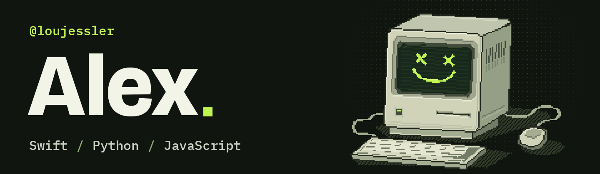

<picture>
  <source media="(max-width: 600px)" srcset="https://raw.githubusercontent.com/loujessler/loujessler/main/assets/cover-mobile.png">
  
</picture>

## MacGenuity

Разрабатываю на Swift утилиту для мышей и микрофонов HyperX. Она показывает заряд мыши прямо в строке меню macOS. Оттуда же можно сменить DPI, настроить подсветку и проверить, включён ли микрофон.

[Скачать для macOS](https://github.com/loujessler/MacGenuity/releases/latest) · [Исходный код](https://github.com/loujessler/MacGenuity)

## Другие проекты

**[TronWalletBot](https://github.com/loujessler/TronWalletBot)** · Python 
Кошелёк в Telegram для отправки и получения TRX.

**[FakeDataGenerator](https://github.com/loujessler/FakeDataGenerator)** · React 
Генератор имён, адресов и телефонов для тестов. Можно выбрать страну и добавить в данные опечатки.
